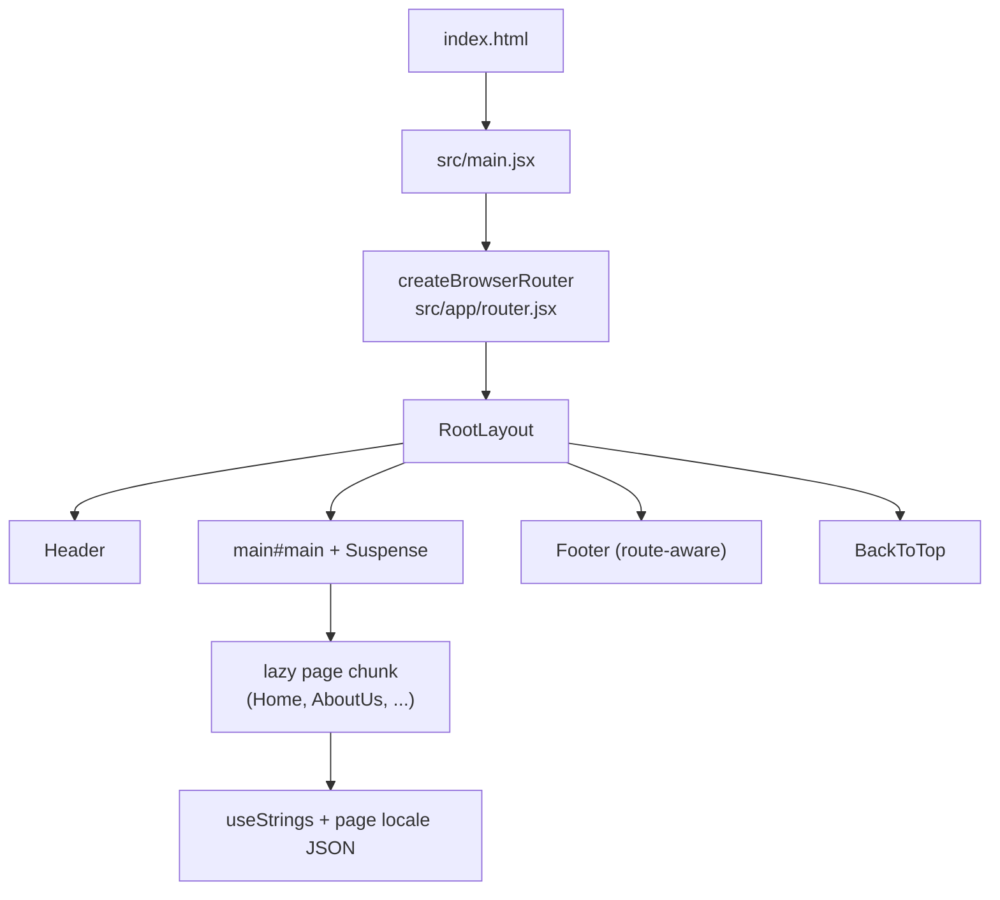

# Architecture

## Request flow

## Routing

`src/app/router.jsx` uses `createBrowserRouter` with a `basename` derived from `import.meta.env.BASE_URL` (trailing slashes stripped). The route table lives in `src/app/routes.jsx` and the lazy page imports in `src/app/pages.jsx`, so every code-split entry is visible in one place and the initial bundle only ships the shell.

| Path | Page |
|---|---|
| `/` | Home |
| `/about-us` | About Us |
| `/services` | Services |
| `/contact` | Contact |
| `/faq` | FAQ Center |
| `/legal/privacy-policy` | Privacy Policy |
| `/legal/term-condition` | Terms & Conditions |
| `*` | NotFound |

Legacy paths (`/privacy-policy`, `/terms`, `/kebijakan-privasi`, `/syarat-ketentuan`) and the Indonesian page aliases (`/tentang-kami`, `/layanan`, `/kontak`) render `<Navigate replace />` to their current equivalents.

## Layout

`RootLayout` (in `src/components/layout/RootLayout.jsx`) renders:

- `LanguageProvider` around everything
- `ScrollToTop`, which resets the scroll position on every pathname change
- a skip link to `#main`
- `Header`
- `<main id="main" class="page">` keyed by pathname, with `Suspense` + `RouteFallback`
- `Footer` (route-aware: the creative-ecosystem gallery only shows on `/services`)
- `BackToTop`

`usePageMeta` (in `src/hooks/usePageMeta.js`) updates `document.title` plus the description and Open Graph tags from `src/data/pageMeta.js` whenever the route or language changes.

Pages do not import chrome themselves.

## Internationalisation

`LanguageProvider` (in `src/i18n/LanguageProvider.jsx`) is the single source of truth for the active language. It keeps `document.documentElement.lang`, `localStorage`, and i18next in sync. Storage key: `lasuarindo-language`, migrated from the legacy `app_language` / `lasuarindo_lang_pref` keys.

`src/i18n/index.js` initialises i18next once and deliberately registers **no** resources. Instead:

- `registerNamespace(namespace, bundle)` deep-merges a `{ id, en }` bundle into i18next.
- `useStrings(bundle, namespace = 'app')` registers the caller's bundle and returns a callable `t` that supports both `t('home.badge')` and object access (`t.home.badge`).

Because each page imports only its own locale JSON, those strings land in that page's lazy chunk — there is no eager locale bundle.

## Styling

Tailwind v4 via `@tailwindcss/vite`. `src/index.css` imports `src/assets/css/{tokens,base,layout,surfaces,chrome,animations}.css`. Colour and font tokens live in `:root` (`tokens.css`) and in `src/constants/theme.js`. See [Styling](/styling).

## Bundling

Vite 8 uses Rolldown. Vendor chunks are defined with `build.rolldownOptions.output.codeSplitting.groups` (React, motion, router, i18n, icons, common). See [Configuration](/configuration).