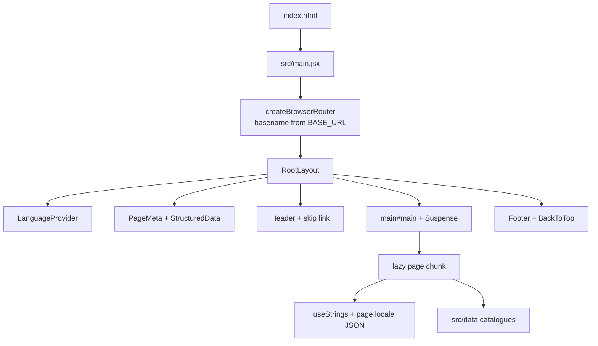

# Architecture

This page is a guided tour of the application code. It explains how a request becomes a page, where content lives, and what each shared piece does. For setup commands, see [Quick start](/docs/quick-start). For the palette and CSS rules, see [Design system](/docs/design-system).

## Runtime flow



## Entry, routing and lazy loading

### Entry point

`src/main.jsx` mounts React and hands routing to the router. It also imports the CSS entry.

```jsx
import { StrictMode } from 'react'
import { createRoot } from 'react-dom/client'
import { RouterProvider } from 'react-router'
import { router } from '@/app/router'
import '@/index.css'

createRoot(document.getElementById('root')).render(
  <StrictMode>
    <RouterProvider router={router} />
  </StrictMode>,
)
```

### Creating the router

`src/app/router.jsx` uses `createBrowserRouter`. The `basename` comes from `BASE_URL` and has trailing slashes removed, because React Router expects a prefix without a trailing slash. For the `lasuarindo.github.io` organisation site, `BASE_URL` is `/`; for a project site it would be `/<repo>/`.

```jsx
const basename = import.meta.env.BASE_URL.replace(/\/+$/, '') || '/'

export const router = createBrowserRouter(
  [
    {
      element: <RootLayout />,
      children: routes,
    },
  ],
  { basename },
)
```

`RootLayout` is the single parent element. All 17 pages are its children.

### Route table and lazy pages

`src/app/routes.jsx` maps a path to a page component. The components themselves come from `src/app/pages.jsx`, where every page is wrapped in `React.lazy`:

```jsx
// src/app/pages.jsx
import { lazy } from 'react'

export const pages = {
  Home: lazy(() => import('@/pages/Home/Home.jsx')),
  AboutUs: lazy(() => import('@/pages/AboutUs/AboutUs.jsx')),
  Businesses: lazy(() => import('@/pages/Businesses/Businesses.jsx')),
  Ecosystems: lazy(() => import('@/pages/Ecosystems/Ecosystems.jsx')),
  District: lazy(() => import('@/pages/Ecosystems/District.jsx')),
  Units: lazy(() => import('@/pages/Units/Units.jsx')),
  UnitDetail: lazy(() => import('@/pages/Units/UnitDetail.jsx')),
  // ... Licence, Legal, Contact, PrivacyPolicy, Terms, Faq,
  // Partnership, Investor, Collaboration, NotFound
}
```

A route then reads from that table:

```jsx
// src/app/routes.jsx
{ path: `${paths.units}/:slug`, Component: pages.UnitDetail }
{ path: '*', Component: pages.NotFound }
```

Each page becomes its own chunk and is fetched when the visitor lands on that URL. `Suspense` lives in `RootLayout`, not in each page.

### Paths as the single source of truth

No component writes a route string inline. `src/app/paths.js` holds the keys, and `routePaths` builds dynamic URLs:

```js
// src/app/paths.js
export const paths = {
  home: '/',
  about: '/about-us',
  vision: '/about-us#visi',
  businesses: '/businesses',
  ecosystems: '/ecosystems',
  units: '/units',
  licence: '/licence',
  contact: '/contact',
  faq: '/faq',
  legal: '/legal',
  privacy: '/legal/privacy-policy',
  terms: '/legal/term-condition',
  partnership: '/partnership',
  investor: '/investor',
  collaboration: '/collaboration',
}

export const routePaths = {
  ecosystem: (key) => `${paths.ecosystems}/${key}`,
  t46: () => routePaths.ecosystem('t46'),
  unit: (slug) => `${paths.units}/${slug}`,
  contactIntent: (intent) => `${paths.contact}?intent=${intent}`,
}
```

Changing a path means changing it here; the route table, navigation data and page links all read from these keys.

### The complete route table

| Path | Page |
|---|---|
| `/` | Home |
| `/about-us` | About Us |
| `/businesses` | Businesses |
| `/ecosystems` | Ecosystem index |
| `/ecosystems/:key` | District page (`t46`, `upcoming`) |
| `/units` | Unit directory |
| `/units/:slug` | Unit detail (12 units) |
| `/licence` | Licensing |
| `/contact` | Contact |
| `/faq` | FAQ |
| `/legal` | Legal index |
| `/legal/privacy-policy` | Privacy Policy |
| `/legal/term-condition` | Terms and Conditions |
| `/partnership` | Partnership |
| `/investor` | Investor relations |
| `/collaboration` | Collaboration |
| `*` | NotFound |

The old `/services` path is retired. It is not registered and falls through to NotFound like any other unknown URL.

Routes fall into four families:

- **Static pages** — Home, About, Businesses, Contact, FAQ and legal documents; copy comes mostly from locale JSON.
- **Data-driven pages** — districts and units; the route is generic and the content comes from catalogues in `src/data/`.
- **Engagement pages** — Partnership, Investor and Collaboration; the same four-section shape with a contact intent. See [Engagement](/pages/engagement).
- **Fallback** — NotFound, also used when a district key or unit slug does not resolve.

## Layout and chrome

### RootLayout composition

`src/components/layout/RootLayout.jsx` is the only place that renders site chrome. Pages render content fragments only.

```jsx
<LanguageProvider>
  <PageMeta />
  <StructuredData />
  <ScrollToTop />
  <SkipLink />
  <Header />
  <main id="main" className="page" key={location.pathname}>
    <Suspense fallback={<RouteFallback />}>
      <Outlet />
    </Suspense>
  </main>
  <Footer />
  <BackToTop />
</LanguageProvider>
```

- `LanguageProvider` supplies the active language to the whole tree.
- `PageMeta` and `StructuredData` write to `document.head`.
- `ScrollToTop` resets scroll on path changes and also waits for hash targets inside lazy pages.
- `SkipLink` targets `#main` for keyboard users.
- `Header` is sticky; `Footer` shows its gallery only on `/businesses`.
- `<main>` is keyed by pathname so a new route remounts its content.
- `Suspense` shows `RouteFallback` while a lazy chunk loads.

### Shared UI components

Components are grouped in `src/components/`:

| Folder | Role | Examples |
|---|---|---|
| `layout/` | Site chrome | `RootLayout`, `Header`, `Footer`, `MobileMenu` |
| `ui/` | Reusable page pieces | `AnimatedReveal`, `Breadcrumb`, `Icon`, `SectionHeader`, `StructuredData`, `UnitCard` |
| `legal/` | Shared legal-page pieces | `LegalLayout`, `LegalSection` |

A typical section uses a few of them together:

```jsx
<AnimatedReveal animation="up" delay={0}>
  <SectionHeader titlePrimary={t.about.valuesHeading1} />
</AnimatedReveal>
<Icon name="arrow_forward" size={18} color="#b12600" />
```

`Icon` reads from Tabler icons; `AnimatedReveal` wraps content with the shared reveal animation and respects reduced-motion preferences.

## Content and data layer

Factual content lives in `src/data/`. These are plain JavaScript modules, not a database. Bilingual fields are `{ id, en }` objects read through `localized(value, language)` from `src/utils/localized.js`.

```js
const description = localized(unit.desc, language)
```

### Catalogues

| File | Feeds |
|---|---|
| `sectors.js` | Home ecosystem grid, Businesses sector sections |
| `units.js` | Unit directory, district pages, unit detail routes |
| `ecosystems.js` | Ecosystem index and the shared district page |
| `licences.js` | Licensing page |
| `company.js` | Contact page, Footer, JSON-LD |
| `navigation.js` | Header, mobile drawer, Footer |
| `pageMeta.js` | Per-route title and description |
| `unitTheme.js`, `unitVisual.js`, `unitEnrichment.js` | Unit detail variants, card imagery and notes |
| `leadership.js`, `network.js`, `timelineDetails.js` | About page |
| `footerGallery.js` | The Businesses-only footer gallery |

An entry in `src/data/sectors.js` shows the shape:

```js
{
  key: 'investment',
  icon: 'trending_up',
  delay: 100,
  title: { id: 'INVESTASI', en: 'INVESTMENT' },
  desc: {
    id: 'Investasi dan kepemilikan bisnis dalam grup melalui PRO.',
    en: 'Investment and business ownership within the group through PRO.',
  },
},
```

Do not put two languages into one string. Names and numbers stay as they are; only translatable fields use the pair.

### Draft status and public fields

Units and ecosystems can carry `status: 'draft'`. The UI then renders a visible badge or note; see the [draft label definition](/docs/guide-contributing#draft-labels). `units.js` lists its public whitelist: slug, sector, ecosystem, name, category, icon, desc, overview, capabilities and status. Internal staff and contract fields are deliberately absent.

## Assets and styling

### CSS entry

`src/index.css` imports Tailwind and the modular stylesheets in a fixed order. The last file, `editorial.css`, is unlayered and wins over Tailwind utilities. See [Design system](/docs/design-system) for the full table and class families.

```css
@import "tailwindcss";
@import "./assets/css/tokens.css";
@import "./assets/css/base.css";
@import "./assets/css/layout.css";
@import "./assets/css/surfaces.css";
@import "./assets/css/chrome.css";
@import "./assets/css/animations.css";
@import "./assets/css/editorial.css";
```

### Images

`src/assets/images/opt/` holds the WebP files the app imports. `raw/` keeps the source JPEGs and is never imported. Imports use the `@` alias:

```jsx
import heroCity from '@/assets/images/opt/jakarta-golden-hour-1562367072-800-opt.webp'


```

`public/` holds files served as-is: favicons, `icons.svg`, `robots.txt` and `sitemap.xml`.

## Hooks

| Hook | Purpose |
|---|---|
| `useResponsive()` | Tracks viewport size and exposes boolean breakpoints |
| `usePageMeta(metaKey, override)` | Keeps title, description, Open Graph and canonical tags in sync |
| `useActiveSection(ids, offset)` | Scroll-spy for anchored tables of contents |

### useResponsive

```js
const { width, height, isMobile, isDesktop } = useResponsive()
```

It listens to `resize` with a passive listener and derives flags such as `isSmallMobile`, `isTablet` and `isWide`.

### usePageMeta

`RootLayout` resolves a key from the pathname and calls the hook with an optional override:

```jsx
const metaKey = resolvePageMetaKey(pathname)
// RootLayout also builds an { id, en } override for /units/:slug.
usePageMeta(metaKey, override)
```

The hook updates `document.title`, `description`, `og:*`, `twitter:*` and the canonical link whenever the route or language changes. Unit detail pages override the generic `unit` entry so each of the twelve units gets its own title and description.

### useActiveSection

Used by the Privacy Policy table of contents:

```js
const activeId = useActiveSection(ids, 120)
```

It follows the last section whose top crossed the sticky header offset. Clicking an entry locks it in place while smooth scrolling runs, then releases the lock on manual scroll.

## Internationalisation

### Initialisation

`src/i18n/index.js` initialises i18next once. It registers **no** resources up front, so locale JSON lands in the page chunk that imports it.

```js
i18n.use(initReactI18next).init({
  lng: initialLanguage,
  fallbackLng: 'id',
  interpolation: { escapeValue: false },
  defaultNS: 'translation',
  initImmediate: false,
})
```

The saved language comes from `localStorage` with key `lasuarindo-language`; Indonesian is the default and fallback. Legacy keys are migrated on load.

### Registering a bundle

`registerNamespace` deep-merges a `{ id, en }` bundle under a namespace, once per language:

```js
export function registerNamespace(namespace, bundle) {
  for (const [lng, resources] of Object.entries(bundle)) {
    i18n.addResourceBundle(lng, namespace, resources, true, true)
  }
}
```

All callers share the `app` namespace, so contributions from different pages merge rather than replace each other.

### useStrings

`useStrings` registers the caller's bundle and returns a translator supporting both access styles:

```js
export function useStrings(bundle, namespace = 'app') {
  registerNamespace(namespace, bundle)
  const { t, i18n: instance } = useTranslation(namespace)
  const language = (instance.language || 'id').split('-')[0]

  return useMemo(() => {
    const dict = instance.getResourceBundle(language, namespace) || {}
    const translator = (key, options) => t(key, options)
    return Object.assign(translator, dict)
  }, [t, instance, language, namespace])
}
```

In a page:

```jsx
const t = useStrings({ id: idHome, en: enHome })
<h1>{t.home.heroTitle1}</h1>
```

`t('home.badge')` is native i18next access; `t.home.badge` is object access from the merged dictionary. Most pages use the object form.

### A page string hook

Pages wrap their own bundle in a small hook, for example `src/pages/Home/useHomeStrings.js`:

```js
import { useStrings } from '@/i18n/useStrings'
import idHome from '@/i18n/locales/id/home.json'
import enHome from '@/i18n/locales/en/home.json'

export function useHomeStrings() {
  return useStrings({ id: { home: idHome }, en: { home: enHome } })
}
```

Because the JSON is imported here, it travels in the Home lazy chunk. `LanguageProvider` keeps `<html lang>`, `localStorage` and `i18n.changeLanguage` in sync. `npm run check:parity` verifies that every `id` key has an `en` counterpart and that no draft marker leaked into copy; CI runs it before the build.

## Pages and sections

A page is a folder under `src/pages/`, with a `Page.jsx` that composes section components from `sections/`:

```jsx
// src/pages/Home/Home.jsx
const t = useHomeStrings()

<HomeHero />
<HomeEcosystem />
<HomeT46Preview />
<HomeImpact />
<HomeJourney />
<FaqTeaser {...t.home.faqTeaser} />
<FinalCta {...t.home.finalCta} />
```

A section imports only the data and locale bundle it needs:

```jsx
// src/pages/Home/sections/HomeEcosystem.jsx
import { sectors } from '@/data/sectors'
import { useHomeStrings } from '../useHomeStrings'

const t = useHomeStrings()
// sectors.map((sector) => ...)
```

Pages do not render the header, footer or page wrapper. They return content fragments that `RootLayout` places inside `<main id="main">`.

## Metadata and SEO

`usePageMeta` runs in `RootLayout` and updates the title, description, Open Graph tags, Twitter card tags and canonical link whenever the route or language changes. `resolvePageMetaKey` in `pageMeta.js` checks nested routes before their parents, so `/units/:slug` and `/ecosystems/t46` do not inherit their parent's metadata. Unit detail pages pass a generated override.

`StructuredData` writes a JSON-LD `Organization` graph on every page and adds `LocalBusiness` on `/ecosystems/t46`. Values come from `company.js`; unverified fields such as coordinates, telephone and founding date are intentionally absent. Static `robots.txt` and `sitemap.xml` live in `public/` and are not generated from the route table.

## Bundling

Vite 8 builds with Rolldown. Vendor chunks are declared with `build.rolldownOptions.output.codeSplitting.groups`:

```js
{
  name: 'vendor/react',
  test: /node_modules[\\/](react|react-dom|scheduler)[\\/]/,
  priority: 20,
}
```

The full group table is in [Configuration](/docs/configuration).

## File map

```
lasuarindo.github.io/
├── .github/workflows/deploy.yml   # app deploy workflow
├── .agents/rules/                 # agent rules, not shipped
├── AGENTS.md, README.md
├── index.html                     # static shell, fonts, default SEO tags
├── package.json, package-lock.json
├── rspress.config.ts              # docs config: root, title, social link
├── vite.config.js                 # base path, alias, plugins, vendor chunks
├── .oxlintrc.json
├── public/                        # favicons, icons.svg, robots.txt, sitemap.xml
├── scripts/check-i18n-parity.mjs  # id/en key parity check
├── docs/                          # Rspress sources (this site)
├── src/
│   ├── main.jsx                   # createRoot + RouterProvider
│   ├── index.css                  # Tailwind entry, imports assets/css/*
│   ├── app/                       # paths, routes, pages, router
│   ├── assets/                    # css/ and images/ (opt/, raw/, logos)
│   ├── components/                # layout/, legal/, ui/
│   ├── constants/                 # theme.js, layout.js
│   ├── data/                      # company, sectors, units, ecosystems, ...
│   ├── hooks/                     # useResponsive, usePageMeta, useActiveSection
│   ├── i18n/                      # index, language, LanguageProvider, useStrings, locales/
│   ├── pages/                     # one folder per area; sections/ inside
│   └── utils/                     # localized.js, scrollToSection.js
├── dist/                          # app build output (gitignored)
└── doc_build/                     # docs build output (gitignored)
```

## Where to change what

| Change | Start here |
|---|---|
| Add or rename an internal URL | `src/app/paths.js`, `routes.jsx`, `pages.jsx` |
| Change a page's translated copy | `src/i18n/locales/{id,en}/<page>.json` |
| Add a business line or unit | `src/data/sectors.js`, `src/data/units.js` |
| Add a district | `src/data/ecosystems.js`; the shared page renders it by key |
| Update contact details | `src/data/company.js` (Footer and Contact read the same object) |
| Change design tokens | `src/constants/theme.js`, `assets/css/tokens.css`, `assets/css/editorial.css` |
