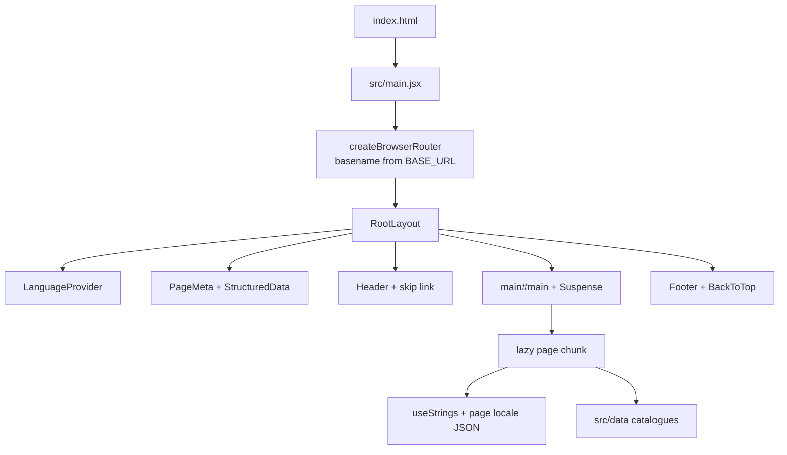
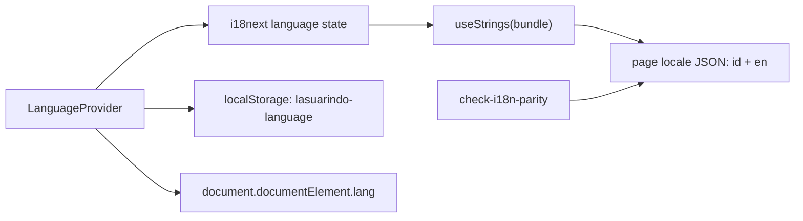

# Architecture

## Runtime flow

## Routing

`src/app/router.jsx` creates the browser router with a `basename` taken from `import.meta.env.BASE_URL` and stripped of trailing slashes. The route table lives in `src/app/routes.jsx`, the lazy imports in `src/app/pages.jsx`, and every internal destination starts as a key in `src/app/paths.js`. The initial bundle therefore ships the shell, not the pages.

| Path | Page |
|---|---|
| `/` | Home |
| `/about-us` | About Us |
| `/businesses` | Businesses |
| `/ecosystems` | Ecosystem index |
| `/ecosystems/:key` | District page (`t46`, `upcoming`) |
| `/units` | Unit directory |
| `/units/:slug` | Unit detail (12 units) |
| `/licence` | Licensing |
| `/contact` | Contact |
| `/faq` | FAQ |
| `/legal` | Legal index |
| `/legal/privacy-policy` | Privacy Policy |
| `/legal/term-condition` | Terms and Conditions |
| `/partnership` | Partnership |
| `/investor` | Investor relations |
| `/collaboration` | Collaboration |
| `*` | NotFound |

The old `/services` path is retired. It is not registered and falls through to NotFound like any other unknown URL.

Routes fall into four families:

- **Static pages** (Home, About, Businesses, Contact, FAQ, legal documents): copy comes mostly from locale JSON.
- **Data-driven pages** (districts and units): the route is generic and the content comes from catalogues in `src/data/`.
- **Engagement pages** (Partnership, Investor, Collaboration): the same four-section shape, with per-page locale bundles and a contact intent. See [Engagement](/pages/engagement).
- **Fallback**: NotFound, also used when a district key or unit slug does not resolve.

## Layout and chrome

`RootLayout` in `src/components/layout/RootLayout.jsx` renders:

- `LanguageProvider` around the whole tree
- `PageMeta` and `StructuredData`, which write to `document.head`
- `ScrollToTop`, including hash-target scrolling into lazy pages
- a skip link to `#main`
- `Header`
- `<main id="main" class="page">` keyed by pathname, with `Suspense` and `RouteFallback`
- `Footer`, whose creative-ecosystem gallery appears only on `/businesses`
- `BackToTop`

Pages do not import the header, footer or page wrapper themselves.

## Internationalisation

`src/i18n/index.js` initialises i18next once with Indonesian as the default and fallback language. It deliberately registers no resources up front. `useStrings(bundle, namespace = 'app')` registers the caller's `{ id, en }` bundle with `registerNamespace` and returns a translator that supports both `t('home.badge')` and `t.home.badge`. Because the page imports its own JSON, those strings land in that page's lazy chunk.

`LanguageProvider` holds the active language, writes the storage key `lasuarindo-language`, updates `<html lang>`, and calls `i18n.changeLanguage`. Legacy storage keys are migrated on load. `npm run check:parity` validates that every `id` key has an `en` counterpart and that no draft marker leaked into published copy; CI runs it before the build.

## Content and data layer

Factual content lives in `src/data/`. Bilingual fields are `{ id, en }` objects read through `localized(value, language)`; proper nouns and numbers stay as they are.

| File | Feeds |
|---|---|
| `company.js` | Contact page, Footer, JSON-LD |
| `sectors.js` | Home ecosystem grid, Businesses sector sections |
| `units.js` | Unit directory, district pages, unit detail routes |
| `ecosystems.js` | Ecosystem index and the shared district page |
| `licences.js` | Licensing page |
| `navigation.js` | Header, mobile drawer, Footer |
| `pageMeta.js` | Per-route title and description |
| `unitTheme.js`, `unitVisual.js`, `unitEnrichment.js` | Unit detail variants, card imagery and notes |
| `leadership.js`, `network.js`, `timelineDetails.js` | About page |

Catalogue entries marked `status: 'draft'` render a visible draft badge or note. See [Ecosystems and Units](/pages/ecosystems-and-units).

## Metadata and SEO

`usePageMeta` runs in `RootLayout` and updates the title, description, Open Graph tags, Twitter card tags and canonical link whenever the route or language changes. `resolvePageMetaKey` in `pageMeta.js` checks nested routes before their parents, and unit detail pages pass a generated override so each of the twelve units gets its own title and description. `index.html` keeps the Home values as a static fallback for crawlers that do not run JavaScript.

`StructuredData` writes a JSON-LD `Organization` graph on every page and adds `LocalBusiness` on `/ecosystems/t46`. Values come from `company.js`; unverified fields such as coordinates, telephone and founding date are intentionally absent.

`resolvePageMetaKey` has no cases for `/partnership`, `/investor` or `/collaboration`, so those three pages use the `notFound` metadata entry. See [Limitations](/docs/limitations).

Static `robots.txt` and `sitemap.xml` are served from `public/`. They are plain files, not generated from the route table, so a new public route has to be added there too.

## Bundling

Vite 8 builds with Rolldown. Vendor chunks are declared with `build.rolldownOptions.output.codeSplitting.groups`; see [Configuration](/docs/configuration) for the group table.
