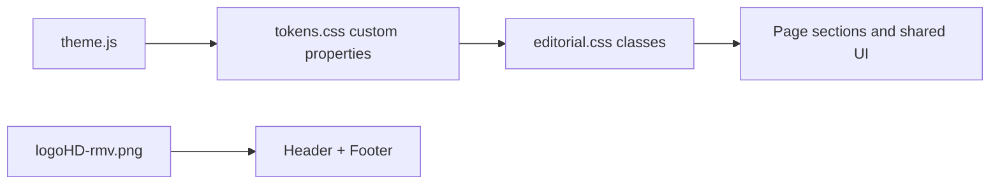

# Brand

This page records the visual identity used by the website. Values under **Brand reference** were sampled directly from the logo assets in this repository; values under **Digital tokens** are what the code currently uses. The two sets are intentionally kept separate because they are not identical.

## Brand marks

| Asset | Description | Used by |
|---|---|---|
| `src/assets/images/logoHD-rmv.png` | Symbol + "PT. LASUARINDO" wordmark, transparent background (509×490) | Header, Footer |
| `src/assets/images/logoHD.png` | Same lockup on a white background (2096×2016) | reference |
| `public/favicon.png` | Symbol only, transparent (512×512) | `index.html` |
| `public/favicon.ico`, `favicon-16x16.png`, `favicon-32x32.png`, `apple-touch-icon.png` | Symbol only, small sizes | `index.html` |

The mark is two open, concentric arcs, a larger outer arc and a smaller inner arc, with the centre left empty. The wordmark is set in uppercase sans-serif, black.

The symbolic meaning of the arcs has not been documented by the company; treat it as **TBD** rather than inventing one.

## Colour

### Brand reference (sampled from logo assets)

| Role | Hex | Note |
|---|---|---|
| Outer arc / primary red | `#E7242C` | Samples also read `#E7252D`, `#E6232B` (anti-aliasing) |
| Inner arc / accent orange | `#F68D22` | Samples also read `#F48E22`, `#F58C21` |
| Wordmark | `#000000` | Black |
| Background | `#FFFFFF` / transparent | Logo assets use both variants |

### Digital tokens (current implementation)

Defined in `src/constants/theme.js`, exposed as CSS custom properties in `src/assets/css/tokens.css`.

| Token | Hex | Typical use |
|---|---|---|
| `--color-primary` | `#b12600` | CTA buttons, active nav/language state, headings |
| `--color-primary-container` | `#d83910` | Button hover, secondary accent |
| `--color-primary-fixed-dim` | `#ffb4a3` | Accent text on dark sections |
| `--color-tertiary` | `#964500` | Tertiary accents |
| `--color-inverse-surface` | `#2f3131` | Dark sections, hero backgrounds |
| `--color-surface` | `#f9f9f9` | Light section background |
| `--color-error` | `#ba1a1a` | Error state only, not a brand colour |

No token matches the logo red exactly. The logo orange is available as `--color-accent-orange` (`#f68d22`), but it stays decorative only. Do not describe `#b12600` or `#d83910` as "the logo colour"; they are the darker digital adaptation.

## Typography

| Role | Family | Source |
|---|---|---|
| Display / headings | Montserrat (600–900) | `--font-display`, loaded in `index.html` |
| Body | Inter (400–700) | `--font-body`, loaded in `index.html` |

The wordmark inside the logo image is a separate, fixed graphic. It is not typeset with Montserrat at runtime and must not be recreated with CSS text.

## How the system reaches the page

`editorial.css` is unlayered and imported last, so its classes decide the final look. Its direction is paper, ink and one red: restrained typography, clear section rhythm, and no gradients or glass effects. See [Styling](/docs/styling) for the class families.

The documentation site uses the same palette: `docs/theme.css` maps these tokens onto Rspress's `--rp-c-*` and `--rp-home-*` variables through `globalStyles` in `rspress.config.ts`. That covers the navbar, page surfaces and the home page hero and feature cards.

## Usage rules

- Use the transparent lockup (`logoHD-rmv.png`) on headers, footers and dark backgrounds. Do not place the white-background `logoHD.png` over a dark section.
- Use `--color-primary` for interactive accents, so links and controls stay distinguishable from decorative logo colours.
- Use `--color-primary-fixed-dim` for accent text on `--color-inverse-surface` sections.
- Keep the wordmark black. Do not recolour the mark to the accent orange.
- Accent orange is decorative only; never use it for body text on white.
- Districts may set their own quiet accent from the approved tokens, but the editorial palette stays the default.

## Accessibility

Contrast against white, computed from the hex values above:

| Colour | Ratio | Result |
|---|---|---|
| `#E7242C` (logo red) | 4.48:1 | Just below AA 4.5:1 for normal text |
| `#F68D22` (logo orange) | 2.40:1 | Fails, decoration only |
| `#b12600` (`--color-primary`) | 6.67:1 | Passes AA for normal text |
| `#d83910` (`--color-primary-container`) | 4.65:1 | Passes AA for normal text |

Use `--color-primary` rather than the raw logo red for small text on white.

## Open questions

These need a decision from the company before they can be written as facts:

- Official brand hex codes, if a brand guideline exists.
- Meaning of the two arcs.
- Minimum clearspace and minimum display size for the mark.
- Monochrome and single-colour variants for print or favicon use.
- Tone of voice for public copy.
