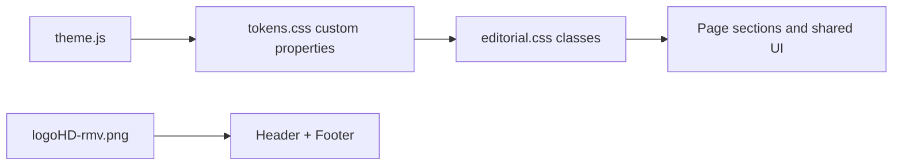

# Design system

This page records the visual identity used by the website and the CSS system that applies it. Values under **Brand reference** were sampled from the logo assets; values under **Digital tokens** are what the code uses. The two sets are intentionally separate.

## Brand marks

| Asset | Description | Used by |
|---|---|---|
| `src/assets/images/logoHD-rmv.png` | Symbol + "PT. LASUARINDO" wordmark, transparent background (509×490) | Header, Footer |
| `src/assets/images/logoHD.png` | Same lockup on a white background (2096×2016) | reference |
| `public/favicon.png` | Symbol only, transparent (512×512) | `index.html` |
| `public/favicon.ico`, `favicon-16x16.png`, `favicon-32x32.png`, `apple-touch-icon.png` | Symbol only, small sizes | `index.html` |

The mark is two open, concentric arcs, a larger outer arc and a smaller inner arc, with the centre left empty. The wordmark is uppercase sans-serif, black. The symbolic meaning of the arcs has not been documented by the company; treat it as **TBD**.

## Colour

### Brand reference

| Role | Hex | Note |
|---|---|---|
| Outer arc / primary red | `#E7242C` | Samples also read `#E7252D`, `#E6232B` (anti-aliasing) |
| Inner arc / accent orange | `#F68D22` | Samples also read `#F48E22`, `#F58C21` |
| Wordmark | `#000000` | Black |
| Background | `#FFFFFF` / transparent | Logo assets use both variants |

### Digital tokens

Defined in `src/constants/theme.js`, exposed as CSS custom properties in `src/assets/css/tokens.css`.

| Token | Hex | Typical use |
|---|---|---|
| `--color-primary` | `#b12600` | CTA buttons, active nav/language state, headings |
| `--color-primary-container` | `#d83910` | Button hover, secondary accent |
| `--color-primary-fixed-dim` | `#ffb4a3` | Accent text on dark sections |
| `--color-tertiary` | `#964500` | Tertiary accents |
| `--color-inverse-surface` | `#2f3131` | Dark sections, hero backgrounds |
| `--color-surface` | `#f9f9f9` | Light section background |
| `--color-error` | `#ba1a1a` | Error state only, not a brand colour |

No token matches the logo red exactly. The logo orange is available as `--color-accent-orange` (`#f68d22`), but it stays decorative only. Do not describe `#b12600` or `#d83910` as "the logo colour"; they are the darker digital adaptation.

### Typography

| Role | Family | Source |
|---|---|---|
| Display / headings | Montserrat (600–900) | `--font-display`, loaded in `index.html` |
| Body | Inter (400–700) | `--font-body`, loaded in `index.html` |

The wordmark inside the logo image is a separate, fixed graphic. It is not typeset with Montserrat at runtime and must not be recreated with CSS text.

## Styling layers

`src/index.css` is the only stylesheet imported by `main.jsx`:

```css
@import "tailwindcss";
@import "./assets/css/tokens.css";
@import "./assets/css/base.css";
@import "./assets/css/layout.css";
@import "./assets/css/surfaces.css";
@import "./assets/css/chrome.css";
@import "./assets/css/animations.css";
@import "./assets/css/editorial.css";
```

| File | Layer | Role |
|---|---|---|
| `tokens.css` | base | CSS custom properties for colour, type and spacing |
| `base.css` | base | Reset, `html`/`body` behaviour, smooth scrolling |
| `layout.css` | components | `.page`, `.section` and grid helpers |
| `surfaces.css` | components | Cards, glass and scrollbar treatments |
| `chrome.css` | unlayered | Header, footer and navigation chrome |
| `animations.css` | unlayered | Entrance and reveal animations |
| `editorial.css` | unlayered | The final visual system, loaded last |

`layout.css` and `surfaces.css` open their own `@layer components` block, so Tailwind utilities still win over them. `editorial.css` is unlayered and imported last, so a semantic class from it wins over an incidental Tailwind utility. Its direction is paper, ink and one red: no gradients, no glass, no per-card scroll reveals.



| Family | Classes | Used for |
|---|---|---|
| Eyebrows | `.eyebrow`, `.eyebrow--light` | Small uppercase section labels |
| Display | `.display`, `.display--hero`, `.display--section`, `.display--card`, `.display--light` | Headings at a single type scale |
| Body | `.lead`, `.lead--light`, `.prose`, `.prose--light` | Introductions and paragraphs |
| Structure | `.wrap`, `.section`, `.section--paper`, `.section--neutral`, `.section--ink`, `.section--tight`, `.rule`, `.split` | Page rhythm and surfaces |
| Controls | `.btn`, `.btn--solid`, `.btn--outline`, `.btn--light`, `.link-arrow` | Calls to action and inline links |

Shared measurements live in `:root`: `--wrap`, `--gutter`, `--section-y` and `--rule`. Page sections import `CONTAINER` and font constants from `src/constants/layout.js` when a class string is shared.

The documentation site maps the same tokens onto Rspress's `--rp-c-*` and `--rp-home-*` variables in `docs/theme.css`; see [Rspress setup](/docs/guide-setup).

## Usage rules

- Use the transparent lockup (`logoHD-rmv.png`) on headers, footers and dark backgrounds. Do not place the white-background `logoHD.png` over a dark section.
- Use `--color-primary` for interactive accents, so links and controls stay distinguishable from decorative logo colours.
- Use `--color-primary-fixed-dim` for accent text on `--color-inverse-surface` sections.
- Keep the wordmark black. Accent orange is decorative only; never use it for body text on white.
- Districts may set their own quiet accent from the approved tokens, but the editorial palette stays the default.
- Prefer Tailwind utilities for local layout adjustments; reach for editorial classes for repeated page patterns.
- Keep inline `style` for genuinely dynamic values, such as a background image URL or an accent colour from a district theme.
- Motion is shared through `AnimatedReveal` and `animations.css`; respect reduced-motion behaviour.

## Horizontal overflow

`html` and `body` in `base.css`, and `.page` in `layout.css`, use `overflow-x: clip` with `width: 100%` / `max-width: 100vw`. The sticky table of contents on the Privacy Policy page depends on this: an ancestor with `overflow-x: hidden` or `auto` becomes the scroll container and `position: sticky` stops working. Use `clip`, never `hidden`.

## Accessibility

Contrast against white, computed from the hex values above:

| Colour | Ratio | Result |
|---|---|---|
| `#E7242C` (logo red) | 4.48:1 | Just below AA 4.5:1 for normal text |
| `#F68D22` (logo orange) | 2.40:1 | Fails, decoration only |
| `#b12600` (`--color-primary`) | 6.67:1 | Passes AA for normal text |
| `#d83910` (`--color-primary-container`) | 4.65:1 | Passes AA for normal text |

Use `--color-primary` rather than the raw logo red for small text on white.

## Open questions

These need a decision from the company before they can be written as facts: official brand hex codes, the meaning of the two arcs, minimum clearspace and display size for the mark, monochrome variants, and tone of voice for public copy.
