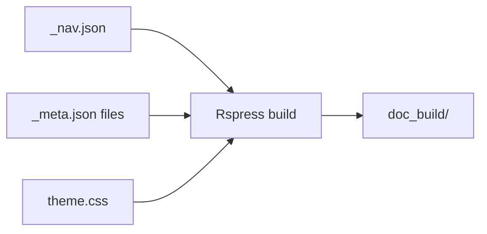

# Rspress Setup

This page is about the documentation site itself. For the application, use the [Docs](/docs/) section.

`rspress.config.ts` at the repository root keeps site-level settings only. It uses `defineConfig` from `@rspress/core` (v2):

- `root: 'docs'`, `title: 'Lasuarindo Docs'`, `lang: 'en'`.
- `plugins: [rspressPluginMermaid()]`, which renders the Mermaid diagrams used in these pages.
- `globalStyles: docs/theme.css`, which maps the site's brand tokens onto Rspress's `--rp-c-*` and `--rp-home-*` variables.
- `themeConfig.socialLinks`: GitHub with the built-in GitHub icon, pointing to `https://github.com/lasuarindo`:

  ```ts
  socialLinks: [
    { icon: 'github', mode: 'link', content: 'https://github.com/lasuarindo' },
  ],
  ```

Navigation is file-based:

- `docs/_nav.json` defines the navbar: For Everyone, Docs, Pages, Changelog. The Docs Guide is a group in the Docs sidebar. The home page opens from the logo.
- Each section folder has its own `_meta.json`. Section headers group links; files and custom links carry the short labels.
- Auto navigation only works while `themeConfig.nav` and `themeConfig.sidebar` stay out of `rspress.config.ts`.

Output is `doc_build/`, which is gitignored. A new or renamed docs page must be added to its folder's `_meta.json`. A new section needs an entry in `_nav.json` and its own `_meta.json`.


