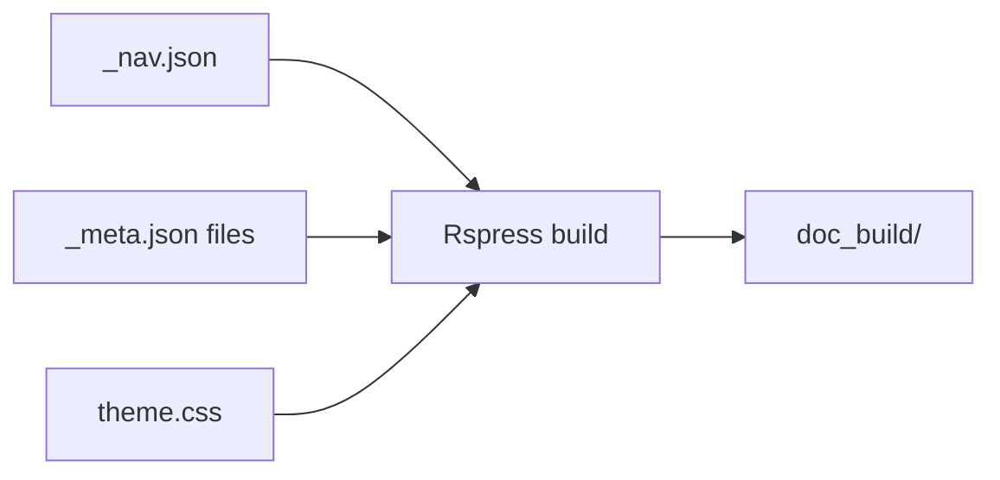

# Rspress Setup

This page is about the documentation site itself. For the application, use the [Docs](/docs/) section.

`rspress.config.ts` at the repository root keeps site-level settings only. It uses `defineConfig` from `@rspress/core` (v2):

- `root: 'docs'`, `title: 'Lasuarindo Docs'`, `lang: 'en'`.
- `plugins: [rspressPluginMermaid()]`, which renders the Mermaid diagrams used in these pages.
- `globalStyles: docs/theme.css`, which maps the site's brand tokens onto Rspress's `--rp-c-*` and `--rp-home-*` variables.
- `themeConfig.socialLinks`: GitHub with the built-in GitHub icon, pointing to `https://github.com/lasuarindo`:

  ```ts
  socialLinks: [
    { icon: 'github', mode: 'link', content: 'https://github.com/lasuarindo' },
  ],
  ```

Navigation is file-based:

- `docs/_nav.json` defines the navbar: For Everyone, Docs, Pages, Changelog. The Docs Guide is a group in the Docs sidebar. The home page opens from the logo.
- Each section folder has its own `_meta.json`. Section headers group links; files and custom links carry the short labels.
- Auto navigation only works while `themeConfig.nav` and `themeConfig.sidebar` stay out of `rspress.config.ts`.

Output is `doc_build/`, which is gitignored. A new or renamed docs page must be added to its folder's `_meta.json`. A new section needs an entry in `_nav.json` and its own `_meta.json`.

### Static assets and home markup

- `docs/public/logo.png` is the symbol-only mark copied from `public/favicon.png`. The `logo` field in `rspress.config.ts` points at it with 28×28 dimensions, so it stays visible in both theme modes.
- The `head` field in `rspress.config.ts` loads the same Inter and Montserrat families as the application's `index.html`.
- `theme/index.tsx` at the repository root replaces three built-in components through ESM re-exports: `HomeHero` renders the masthead with the visible `<h1>` and two text links, `HomeFeature` renders the six features as a numbered index instead of cards, and `SocialLinks` gives the GitHub icon an accessible name. It imports the original `SocialLinks` CSS explicitly, because re-exporting a component drops its own stylesheet import, and ends with `export * from '@rspress/core/theme-original'` so every other component remains built-in. The layout lives in `.docs-hero` and `.docs-index` in `docs/theme.css`.

### Navbar: `docs/_nav.json`

```json
[
  { "text": "For Everyone", "link": "/for-everyone/", "activeMatch": "^/for-everyone/" },
  { "text": "Docs", "link": "/docs/", "activeMatch": "^/docs/" },
  { "text": "Pages", "link": "/pages/", "activeMatch": "^/pages/" },
  { "text": "Changelog", "link": "/changelog/", "activeMatch": "^/changelog/" }
]
```

`activeMatch` is a regular expression string. The home page is reached from the logo and its `pageType: home` front matter, not from a navbar item.

### Sidebar: `docs/docs/_meta.json`

The Docs sidebar is one example. The five section headers are plain labels, not collapsible groups:

```json
[
  { "type": "section-header", "label": "Start here" },
  { "type": "file", "name": "index", "label": "Overview" },
  { "type": "file", "name": "quick-start", "label": "Quick start" },
  { "type": "file", "name": "how-to", "label": "How-to recipes" },
  { "type": "divider" },
  { "type": "section-header", "label": "Understand" },
  { "type": "file", "name": "architecture", "label": "Architecture" },
  { "type": "file", "name": "configuration", "label": "Configuration" },
  { "type": "file", "name": "design-system", "label": "Design system" },
  { "type": "divider" },
  { "type": "section-header", "label": "Ship it" },
  { "type": "file", "name": "deployment", "label": "Deployment" },
  { "type": "file", "name": "troubleshooting", "label": "Troubleshooting" },
  { "type": "divider" },
  { "type": "section-header", "label": "Docs Guide" },
  { "type": "file", "name": "guide-overview", "label": "Docs Guide" },
  { "type": "file", "name": "guide-setup", "label": "Setup" },
  { "type": "file", "name": "guide-contributing", "label": "Contributing" },
  { "type": "divider" },
  { "type": "section-header", "label": "More" },
  { "type": "custom-link", "link": "/for-everyone/", "label": "For Everyone" },
  { "type": "custom-link", "link": "/pages/", "label": "Pages" },
  { "type": "custom-link", "link": "/changelog/", "label": "Changelog" }
]
```

The other section folders follow the same pattern with their own files: `for-everyone/_meta.json`, `pages/_meta.json` and `changelog/_meta.json`.

### Theme overrides: `docs/theme.css`

`globalStyles` loads this file. It maps the app's digital tokens onto Rspress variables; an excerpt:

```css
:root {
  --rp-c-brand: #b12600;          /* --color-primary */
  --rp-c-brand-light: #ffb4a3;    /* --color-primary-fixed-dim */
  --rp-c-bg: #fbfaf8;             /* --color-paper */
  --rp-c-text-0: #1b1b1a;         /* --color-ink */
  --rp-c-link: var(--rp-c-brand);

  --rp-home-background-bg: #fbfaf8;          /* --color-paper */
  --rp-home-hero-title-bg: #b12600;          /* --color-primary */
  --rp-home-hero-title-color: #b12600;
}

html.rp-dark,
html.dark {
  --rp-c-brand: #ffb4a3;
  --rp-c-bg: #1b1b1a;
  --rp-c-text-0: #f7f5f1;
  --rp-c-link: var(--rp-c-brand);
  --rp-home-background-bg: #1b1b1a;          /* --color-ink */
  --rp-home-hero-title-bg: #b12600;          /* --color-primary */
  --rp-home-hero-title-color: #ffb4a3;       /* accent text on ink */
}
```

The `--rp-c-*` variables style ordinary pages; the `--rp-home-*` variables feed the home's background and masthead. The dark selector swaps both families at once. The visible home title reads its colour from `--rp-home-hero-title-color`, so the light red and the dark accent stay separate from the brand used for links and rules.



Next: [Contributing](/docs/guide-contributing).
