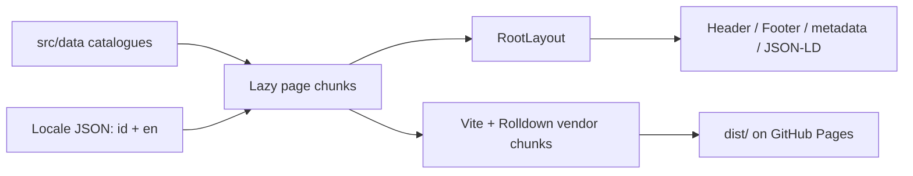

# Project Documentation

Technical documentation for the Lasuarindo Group website. This section explains the application: its structure, data, runtime behaviour and deployment. It is for people who work on the code. For the documentation site itself, use the [Docs Guide](/docs/guide-overview). For a non-technical explanation, use [For Everyone](/for-everyone/). For notes on every page, use [Pages](/pages/).

## At a glance

| | |
|---|---|
| Product | Bilingual (Indonesian / English) company profile |
| App | React 19, React Router 7, Vite 8 with Rolldown, Tailwind CSS 4 |
| Content | i18next + react-i18next, one locale bundle per page |
| Data | `src/data/` catalogues with `{ id, en }` fields |
| Routes | 17 lazy routes, including data-driven district and unit details |
| Docs | Rspress v2, configured in `rspress.config.ts` |
| Publication | GitHub Pages via GitHub Actions on `main` |

## What visitors can do

- Read the group's profile, vision, values and leadership.
- Explore six business lines and twelve business units in the T46 district.
- Open a district page or a detail page for an individual unit.
- Check basic licensing information and the legal documents.
- Use the FAQ and the contact form to start a partnership, investor or collaboration conversation.

The three engagement topics have their own pages, described in [Engagement](/pages/engagement).

## How the site is built

Routing uses `createBrowserRouter` with a `basename` derived from `BASE_URL`. Every page is a lazy chunk, and `RootLayout` supplies the shared chrome. Translations are registered per page through `useStrings`, so a locale bundle travels with the page that needs it. Styling is Tailwind CSS 4 plus a small, unlayered editorial system. CI checks locale parity, builds the app, and deploys it with an SPA fallback.

## Where to go next

| I want to... | Go to |
|---|---|
| Run a local copy and make a verified change | [Quick start](/docs/quick-start) |
| Follow a step-by-step task | [How-to recipes](/docs/how-to) |
| Map responsibilities to files | [Architecture](/docs/architecture) |
| Change configuration or validate translations | [Configuration](/docs/configuration) |
| Work on colours, type or layout | [Design system](/docs/design-system) |
| Read about a specific route | [Pages](/pages/) |
| Understand how CI publishes the site | [Deployment](/docs/deployment) |
| Fix a build or behaviour problem | [Troubleshooting](/docs/troubleshooting) |
| Understand how this documentation site works | [Docs Guide](/docs/guide-overview) |

Some catalogue entries are marked draft. See the [draft label definition](/docs/guide-contributing#draft-labels). When adding content, add both `id` and `en`, then run `npm run check:parity`.
