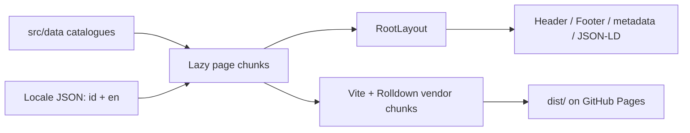
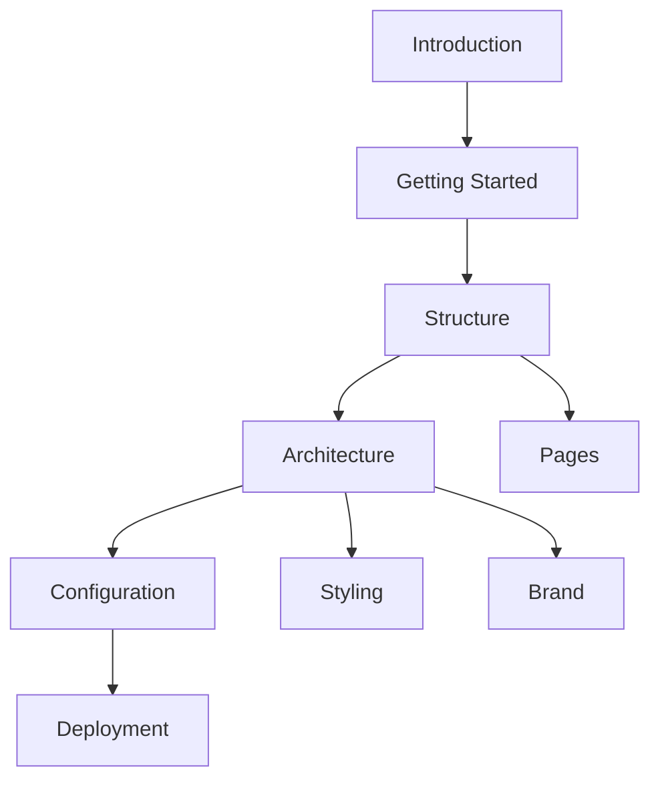

# Introduction

This repository is the public website for **PT Lasuarindo Group**, an integrated business and investment group. It is a bilingual company profile (Indonesian and English) published to GitHub Pages.

## At a glance

| | |
|---|---|
| Product | Bilingual (Indonesian / English) company profile |
| App | React 19, React Router 7, Vite 8 with Rolldown, Tailwind CSS 4 |
| Content | i18next + react-i18next, one locale bundle per page |
| Data | `src/data/` catalogues with `{ id, en }` fields |
| Routes | 17 lazy routes, including data-driven district and unit details |
| Docs | Rspress v2, configured in `rspress.config.ts` |
| Publication | GitHub Pages via GitHub Actions on `main` |

## What visitors can do

- Read the group's profile, vision, values and leadership.
- Explore six business lines and twelve business units in the T46 district.
- Open a district page or a detail page for an individual unit.
- Check basic licensing information and the legal documents.
- Use the FAQ and the contact form to start a partnership, investor or collaboration conversation.

The three engagement topics have their own pages, described in [Engagement](/pages/engagement).

## How the site is built

Each part of that diagram has a dedicated page. Start with [Architecture](/docs/architecture) for the runtime view and [Structure](/docs/project-structure) for the file view.

## Key features

- Routing uses `createBrowserRouter` with a `basename` derived from `BASE_URL`. Every page is a lazy chunk, and `RootLayout` supplies the shared chrome.
- Translations are registered per page through `useStrings`, so a locale bundle travels with the page that needs it. `LanguageProvider` keeps `<html lang>` and `localStorage` in sync.
- Styling is Tailwind CSS 4 plus a small, unlayered editorial system that has the final say on how things look. See [Styling](/docs/styling).
- Content that describes the group lives in `src/data/`, with bilingual values resolved by `localized()`.
- CI checks locale parity, builds the app, and deploys it with an SPA fallback. See [Deployment](/docs/deployment).
- The documentation site itself is built with Rspress v2 from `docs/`.

## Where to go next

| I want to... | Go to |
|---|---|
| Understand how this documentation site works | [Guide](/guide/) |
| Read about the website in everyday language | [For Everyone](/for-everyone/) |
| Run a local copy and learn the checks | [Getting Started](/docs/getting-started) |
| Map responsibilities to files | [Structure](/docs/project-structure) |
| Understand routing, i18n, metadata and bundling | [Architecture](/docs/architecture) |
| Change configuration or validate translations | [Configuration](/docs/configuration) |
| Work on colours, type or layout | [Brand](/docs/brand), [Styling](/docs/styling) |
| Read about a specific route | [Pages](/pages/) |
| Understand how CI publishes the site | [Deployment](/docs/deployment) |

## Draft content

A few sections are labelled draft in the interface: the planned district, the licensing page, engagement programme details, and parts of the About timeline and unit copy. The labels are intentional. They tell readers which statements are illustrative and which are verified, and they should not be removed until the underlying data is confirmed. When you add content, add both `id` and `en`, then run `npm run check:parity`.
