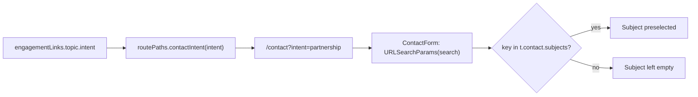

# Engagement

These three pages explain the different ways visitors can work with the group.

## What you can find

- **Partnership** for organisations that want to build something together with the group.
- **Investor relations** for people interested in investing in or with the group's businesses.
- **Collaboration** for institutions and communities that want to run joint activities.

Each page follows the same simple shape: why the topic matters, who it suits, how a first conversation usually starts, and what kind of cooperation might follow.

## Where it links

Each page ends with a contact invitation. Following it opens the contact form with the right subject already filled in. The form validates entries in your browser; it does not send messages. See [Contact](/pages/contact).

**Programme details.**

Programme details are marked draft on each page, so treat the listed formats as illustrative rather than final. You can find the three pages in the site footer and on the Contact page.

## Paths and contact intents

`src/app/paths.js` is the single source of truth for internal destinations. `engagementLinks` adds a locale label key, a route and a contact intent to each topic:

```js
// src/app/paths.js
export const routePaths = {
  ecosystem: (key) => `${paths.ecosystems}/${key}`,
  t46: () => routePaths.ecosystem('t46'),
  unit: (slug) => `${paths.units}/${slug}`,
  contactIntent: (intent) => `${paths.contact}?intent=${intent}`,
};

/** Key -> path + intent + locale label, used by journey links and engagement pages. */
export const engagementLinks = {
  partnership: {
    labelKey: 'engagement.partnership',
    to: paths.partnership,
    intent: 'partnership',
  },
  investor: {
    labelKey: 'engagement.investor',
    to: paths.investor,
    intent: 'investor',
  },
  collaboration: {
    labelKey: 'engagement.collaboration',
    to: paths.collaboration,
    intent: 'collaboration',
  },
};
```

Each topic's hero and offer CTA call `routePaths.contactIntent(link.intent)`, producing `/contact?intent=partnership`, `/contact?intent=investor` or `/contact?intent=collaboration`. `ContactForm` reads that query string and uses the intent as its initial subject only when the value is a real key in `t.contact.subjects`:

```js
// src/pages/Contact/sections/ContactForm.jsx
const { search } = useLocation();
const intent = new URLSearchParams(search).get('intent');
const initialSubject =
  intent && Object.prototype.hasOwnProperty.call(t.contact.subjects, intent)
    ? intent
    : '';

const [subject, setSubject] = useState(initialSubject);
```

The three subject labels live in the `en` and `id` contact bundles under `subjects`.



## For maintainers

- Routes: `/partnership`, `/investor` and `/collaboration`, each with its own page folder and locale bundle.
- `engagementLinks` in `src/app/paths.js` maps topic → label key, route and contact intent.
- CTAs build `/contact?intent=<topic>`; `ContactForm` preselects the matching subject.
- Each Offer section renders `DraftNote` until programme details are confirmed.
- Caveat: `resolvePageMetaKey` has no cases for these routes, so they currently use the `notFound` metadata entry.
